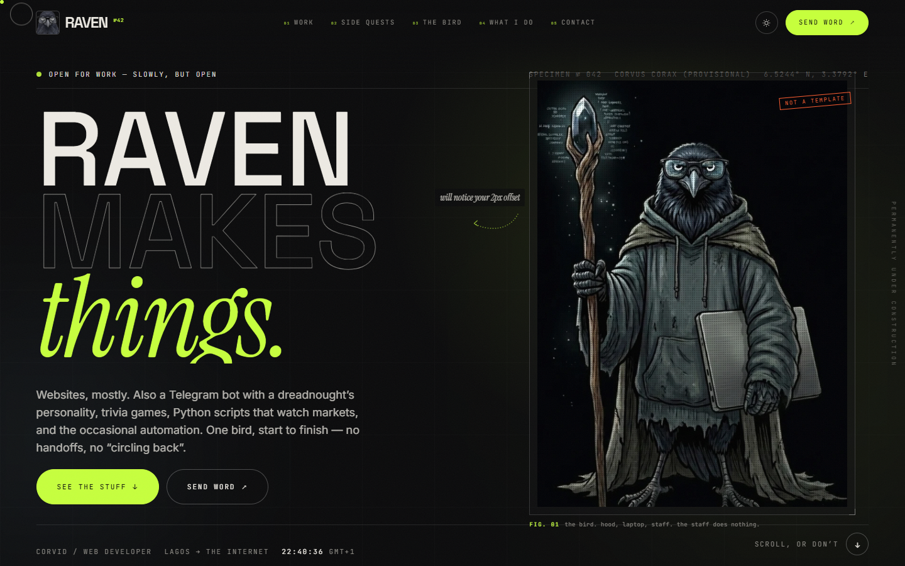

# RAVEN — portfolio



A portfolio for **Raven**, a web developer in Lagos who happens to be a bird. Built as a
specimen record rather than a résumé: field notes, catalogue numbers, footnotes, a specimen
sheet, and four live client sites presented as evidence.

Everything on the page is editable from `src/data/*` — no component edits needed to change copy.

---

## What's in it

- **Home** — hero, capability belt, pinned horizontal work section, **side quests** (the things
  that aren't client websites), the bird (specimen sheet, footnotes, known bugs, special
  interests), capabilities accordion, lifecycle process, testimony (deliberately empty, see
  below), contact form and a sticky-reveal footer.
- **Side quests** — a ledger of the non-client work: the Warhammer dreadnought Telegram bot (with a
  sample exchange rendered as a terminal), browser trivia and rebus games, Python market scripts,
  the binary options script, the blog, and AI chat workflows. Each has a stack, a deadpan note and
  an honest status word ("Alive, mostly", "Retired", "Dabbling").
- **Case studies** — one templated page at `/work/:slug` for each of the four projects: full-bleed
  hero in the client's own palette, meta row, overview / challenge / what I built / results,
  screenshot gallery with a lightbox, and a click-to-load live `<iframe>` preview with a graceful
  fallback for sites that block embedding.
- **404** — with the raven's face and a route back into the work.
- **Terminal easter egg** — press <kbd>~</kbd> anywhere. Commands: `help`, `work`, `open <slug>`,
  `contact`, `socials`, `theme`, `whoami`, `caw`, `worm`, `clear`, `exit`.
- **Preloader, custom cursor, magnetic buttons, masked text reveals, scroll-scrubbed lead line,
  velocity-reactive marquee, count-up-free stats, route wipe, scroll progress, theme toggle with a
  circular View Transition, sticky-reveal footer.**
- Everything above degrades: `prefers-reduced-motion` disables Lenis, the pinned work sequence,
  parallax, the custom cursor and the preloader, and swaps motion for simple fades.

### The four records

| # | Project | What it is | Live |
|---|---------|------------|------|
| 01 | Zanori Spaces | Interior & exterior design gallery, custom domain | [zanorispaces.com](https://zanorispaces.com/) |
| 02 | Apreeltree | Premium Nigerian food bulk export, B2B catalogue | [apreeltree.onrender.com](https://apreeltree.onrender.com/) |
| 03 | Fitables Beauty Bar | Luxury spa booking across three Lagos locations | [fitables.onrender.com](https://fitables.onrender.com/) |
| 04 | DUDJA | Official site for a Boston artist (music, vision, merch, booking) | [dudja.onrender.com](https://dudja.onrender.com/) |

Screenshots were captured from the live sites with headless Chrome, then compressed to WebP
(≤1600px wide, q80) with `sharp`. See `docs/image-manifest.json` for dimensions.

---

## Stack

| Layer | Choice |
|-------|--------|
| Build | Vite 5 + React 18 + TypeScript (strict, no `any`) |
| Styling | Tailwind CSS 3 with design tokens in `tailwind.config.ts`, plus a small custom layer in `src/styles/index.css` |
| Animation | Framer Motion (component/layout/route), GSAP + ScrollTrigger (pinned work sequence), Lenis (smooth scroll, driven by the GSAP ticker) |
| Routing | React Router 6, case study route code-split |
| Forms | React Hook Form + Zod |
| Type | Space Grotesk (display), Instrument Serif (italic accents), Inter (text), JetBrains Mono (labels) — self-hosted, latin subset only |
| Images | `sharp` for asset generation |
| Lint/format | ESLint (+ jsx-a11y) and Prettier |

No Three.js: the raven artwork is the hero, and shipping a WebGL scene would have cost more
performance than it added. The interactive hero background is CSS + a rAF-throttled pointer
spotlight instead.

## Run it

```bash
npm install
npm run dev        # http://localhost:5173
npm run build      # tsc --noEmit && vite build
npm run preview    # http://localhost:4173
npm run lint
npm run format
```

Node 20+ recommended (built on Node 22).

## Editing content

| File | Controls |
|------|----------|
| `src/data/site.ts` | Name, email, phone, WhatsApp, socials, availability, SEO title/description, nav items |
| `src/data/projects.ts` | The four case studies: copy, facts, palette, screenshot paths, live URLs |
| `src/data/quests.ts` | Side quests (bots, games, scripts, blog) + the dreadnought sample exchange |
| `src/data/services.ts` | The capabilities accordion |
| `src/data/skills.ts` | Marquee items, tools grid, lifecycle steps, special interests, known bugs |
| `src/data/testimonials.ts` | Client quotes (currently empty on purpose — see below) |
| `src/data/bird.ts` | The artwork and its captions |
| `src/styles/index.css` | Colour tokens for both themes, grain, halftone, tape, stamps |

### Assets

- `public/bird/` — the original Raven renders (`raven-group`, `raven-portrait`, `raven-moon`,
  `raven-blob`, `raven-lego`) plus `raven-logo.webp`, the square face crop used as the logo.
- `public/favicon.png` (+ 32/192/apple variants) — the original Raven favicon from the old site.
- `public/projects/<slug>/{hero,full,mobile}.webp` — live captures.
- `npm run og` regenerates `og-image.png` and `site.webmanifest`.
- `npm run images` re-cuts the project screenshots (expects a `SOURCE` folder of raw captures).

## Environment variables

Copy `.env.example` to `.env` and fill in what you need. Nothing is required: with no keys the
contact form falls back to opening the visitor's mail client with the message pre-filled — it
never pretends to have sent something.

| Variable | Purpose |
|----------|---------|
| `VITE_FORMSPREE_FORM_ID` | Formspree form id. When set, the form POSTs to Formspree. |
| `VITE_CONTACT_EMAIL` | Fallback address for the `mailto:` handoff. |
| `VITE_SITE_URL` | Public origin, if you want it available at runtime. |

`.env` is gitignored; only `.env.example` is committed.

## Deploy

Both configs are in the repo, with SPA rewrites and immutable caching for hashed assets.

**Render** — `render.yaml` is a static site blueprint:

```bash
# New → Blueprint → point at this repo, or:
render.com → New Static Site → build: npm install && npm run build → publish: dist
```

**Vercel** — `vercel.json` sets the build command, output directory and the same rewrites:

```bash
npx vercel --prod
```

**GitHub Pages / any static host** — build and serve `dist`, with a catch-all rewrite to
`index.html`. If you deploy under a sub-path, set Vite's `base` accordingly.

After deploying, replace the placeholder origin in `src/data/site.ts`, `index.html`,
`public/robots.txt` and `public/sitemap.xml` with the real domain.

---

## Design notes (and the bolder calls)

- **The concept is a specimen record.** The site treats Raven like a field-study entry: catalogue
  number, specimen sheet, figure captions, annotations, footnotes, "known bugs". It gives the
  page a voice that a stack of rounded cards cannot, and it lets the personality live in the
  margins without getting in the way of a client reading the work.
- **Acid lime `#C6FF3D`** on near-black `#0A0A0B`, with a warm paper light theme. Lime holds up
  against all four client palettes (brown interiors, cream export site, ivory spa, black artist
  site) without colliding with any of them. A second accent, oxide `#FF5C2E`, is reserved for
  stamps and errors so it never competes with the signature colour.
- **Work is a pinned horizontal sequence** on desktop, and a plain vertical stack on mobile and
  for reduced-motion users. The switch is CSS-only (`.work-horizontal` / `.work-stack`) so React
  never unmounts a subtree that ScrollTrigger has re-parented — that combination used to throw
  `removeChild` errors on resize.
- **No invented testimonials.** The testimony section says, in public, that nothing is on the
  record yet and shows redacted placeholder cards. Fabricating a quote and putting it in a
  client's mouth is a strange thing to do; the empty state is styled as intentional instead.
- **Side quests get their own section.** Raven makes more than websites, but a client reading the
  page needs the paid work first. The quests ledger sits directly under the case studies and is
  explicitly unpaid ("Unpaid, unbothered") so range reads as range, not as a service menu.
- **No invented metrics.** Case-study "results" only contain facts observable from the live
  sites (product counts, locations, prices, published claims), and each page says where those
  numbers come from.
- **The bird is the logo.** The old site's artwork is reused deliberately: the header mark is a
  crop of the original raven portrait, and the favicon is the original Raven icon.
- **Terminal over Konami.** A `~` terminal fits a developer portfolio better than a cheat code,
  and it can actually answer questions (`work`, `contact`, `open fitables`).

## Accessibility

- Semantic landmarks, a skip link, visible focus rings, and `aria-current` on the active nav item.
- Accordion uses real buttons with `aria-expanded` / `aria-controls`; the carousel is
  keyboard-operable and labelled; the terminal traps focus and closes on `Esc`.
- Every image has alt text (decorative artwork is `aria-hidden` where the caption carries it).
- AA contrast in both themes; motion respects `prefers-reduced-motion`.

## Performance

Lighthouse (Chrome, mobile preset, throttled), measured against the production build:

| Category | Score |
|----------|-------|
| Accessibility | **100** |
| Best practices | **100** |
| SEO | **100** |
| Performance | **67** |

Metrics behind that: FCP 3.6s, LCP 6.1s, TBT 130ms, CLS 0.004. The page is a client-rendered React
app with a large animated hero, so the first paint waits on ~135KB of gzipped JavaScript (React +
Framer Motion + the hero/featured work). On a throttled mobile CPU that is the whole bottleneck —
LCP is the hero h1/plate, not an image or font problem. What is already done:

- GSAP + ScrollTrigger load only when the work section is near (separate `gsap` chunk).
- Side quests, Services, Process, Testimony and Contact are lazy chunks mounted within 1.2
  viewports, and their anchor ids live on always-present wrappers so nav jumps never miss.
- Fonts are self-hosted, latin-only, and the three faces used above the fold are preloaded, which
  removed essentially all layout shift (CLS 0.004).
- Case-study routes are code-split; offscreen sections use `content-visibility: auto`.
- All imagery is WebP with explicit dimensions and lazy loading below the fold.

If 90+ mobile performance is a hard requirement, the next step is server-rendering the hero and the
work list (Vite SSR or Astro) so the first paint no longer waits on the bundle. That is a different
architecture, not a tweak, so it was left out of this build.


## TODO for Raven

- [ ] **Domain** — replace `https://0xjave-dot.github.io/portfolio` in `src/data/site.ts`,
      `index.html` (canonical + OG), `public/robots.txt`, `public/sitemap.xml`.
- [ ] **Testimonials** — add real, verbatim quotes in `src/data/testimonials.ts` and set
      `placeholder: false`. The section starts auto-advancing as soon as one real quote exists.
- [ ] **Social links** — LinkedIn and X are `pending` in `src/data/site.ts`.
- [ ] **Contact form** — create a Formspree form and set `VITE_FORMSPREE_FORM_ID`, or leave it and
      the `mailto:` fallback handles delivery.
- [ ] **Client sign-off** — confirm each client is happy to be named and linked on a personal
      portfolio, and confirm the year on each record (all currently `2026`, from the live sites).
- [ ] **Metrics** — the "site claims" in each case study (14 countries, 500+ orders, 2,000+
      clients, etc.) are the clients' own published figures; replace or remove them if they are
      out of date.
- [ ] **Side quests** — confirm the status words in `src/data/quests.ts` ("Alive, mostly",
      "Running", "Retired", "Ran it", "Dabbling") still match reality, and add links or repos if
      any are public. The binary options entry is written as a cautionary aside rather than a
      service — keep it that way or cut it.
- [ ] **Artwork** — the raven renders and the favicon come from the old portfolio. Make sure you
      own or are licensed to reuse them, and swap in higher-resolution originals if you have them
      (`public/bird/`, keep the same filenames).
- [ ] **OG image** — regenerate (`npm run og`) after changing the name or tagline.

## Structure

```
portfolio/
  public/
    bird/                 raven artwork + logo crop
    projects/<slug>/      hero.webp, full.webp, mobile.webp
    favicon*.png, og-image.png, robots.txt, sitemap.xml, site.webmanifest
  src/
    components/
      cursor/             custom cursor
      layout/             Navbar, Footer, Preloader, PageCurtain, ScrollProgress
      motion/             Parallax
      providers/          ThemeProvider, SmoothScroll (Lenis + GSAP ticker)
      sections/           Hero, MarqueeStrip, Work, SideQuests, About, Services, Process, Testimonials, Contact
      terminal/           Terminal easter egg
      ui/                 SplitText, Reveal, MagneticButton, Marquee, Lightbox, Toast, Annotation
    data/                 site, projects, quests, services, skills, testimonials, bird
    hooks/                useLenis, useMagnetic, useMediaQuery, useReducedMotion, useLocalTime, …
    lib/                  utils, gsap, seo, intro, contexts
    pages/                Home, CaseStudy, NotFound
    styles/               fonts.css, index.css
  docs/                   old-site-analysis.md, image-manifest.json, screenshot.png
  scripts/                og-image.mjs, optimise-images.mjs
  render.yaml, vercel.json, .env.example
```

## Credits

Design and build: Raven. Type: Space Grotesk, Instrument Serif, Inter, JetBrains Mono (all
open-licensed, self-hosted). Client screenshots belong to their respective owners.
